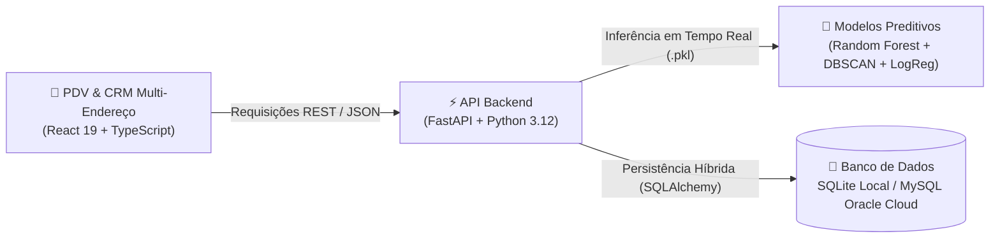

# 📦 CubeBox Mini — Sistema Preditivo Integrado de Compras e Vendas

> **Solução Full-Stack & Inteligência de Dados para Mercados de Proximidade e Lojas de Conveniência**  
> **Metodologia:** CRISP-DM (*Cross-Industry Standard Process for Data Mining*) + SDD (*Spec-Driven Development*)  
> **Stack Principal:** React 19 + TypeScript + FastAPI (Python 3.12) + SQLAlchemy + Scikit-Learn + Joblib

---

## 🎯 Visão Geral do Sistema

O **CubeBox Mini** foi desenvolvido para solucionar o principal gargalo operacional e financeiro do varejo de conveniência: **o equilíbrio entre a ruptura de estoque (falta de produto na gôndola e perda de venda) e o custo de capital imobilizado (dinheiro parado em excesso de mercadorias)**.

O sistema une a agilidade do **frente de caixa (PDV)** e a fidelização do **relacionamento com clientes (CRM)** ao poder da **ciência de dados e inteligência artificial**, entregando previsões acionáveis diretamente no fluxo de trabalho do lojista.



---

## 🌟 Principais Módulos do Sistema

| Módulo | O que faz no dia a dia? | Benefício Prático |
| :--- | :--- | :--- |
| **🛒 PDV Inteligente** | Registro veloz de vendas com múltiplos pagamentos (PIX, cartões, dinheiro e splits de pagamento), emissão de cupom 80mm e botão de recompra rápida em 1 clique. | Reduz o tempo de fila no caixa e evita perdas por lentidão operacional. |
| **👥 CRM & Master-Detail** | Gestão de clientes com múltiplos endereços de entrega, visualização instantânea de histórico de pedidos, métricas de RFM e valor de ciclo de vida (LTV). | Agiliza entregas e permite ações comerciais personalizadas com base no consumo. |
| **🔮 Cockpit Preditivo** | Gráficos com projeções multi-item para os próximos 7 a 30 dias com datas do calendário real e linhas cromáticas acessíveis (WCAG 2.1 AA). | Permite ao lojista saber exatamente quanto vai vender e planejar compras com precisão. |
| **📦 Gestão de Ruptura & Giro** | Classificação de giro de mercadorias via DBSCAN e matriz calibrada de probabilidade de ruptura via Regressão Logística Multinomial. | Alerta com antecedência quais itens estão prestes a faltar ou encalhar na loja. |
| **📊 Catálogo Realista (93 SKUs)** | Portfólio completo em 13 categorias (cervejas, destilados, tabacaria, snacks, congelados, mercearia, etc.) com outliers reais de ticket (R$ 1,53 a R$ 983,40). | Fornece dados estatisticamente ricos para treinamento de modelos e simulação fiel à realidade. |

---

## 🛠️ Tecnologias Utilizadas

- **Frontend:** React 19, TypeScript, Vite, CSS Modules, Lucide React, Design Tokens W3C DTCG (Dual-Theme: Cerúleo e Grafite).
- **Backend:** FastAPI, Python 3.12, Pydantic v2, Uvicorn, SQLAlchemy 2.0.
- **Ciência de Dados & Machine Learning:** Scikit-Learn, Pandas, NumPy, Joblib, JupyterLab, Seaborn, Matplotlib.
- **Banco de Dados (Híbrido):** SQLite (desenvolvimento local e testes rápidos) e MySQL 8.4 LTS na Oracle Cloud Infrastructure (produção).

---

## 🚀 Guia Passo a Passo de Instalação e Execução

Siga os blocos abaixo para configurar e executar o ambiente de forma rápida e organizada.

```
[Bloco 1] Pré-Requisitos ➔ [Bloco 2] Configuração (.env) ➔ [Bloco 3] Instalação ➔ [Bloco 4] Modelos de IA ➔ [Bloco 5] Execução
```

---

### 🧱 Bloco 1: Pré-Requisitos do Ambiente

Certifique-se de possuir instalado em sua máquina:
- **Node.js:** Versão 18.0.0 ou superior (recomendado 20 LTS).
- **Python:** Versão 3.10 ou superior (recomendado 3.12).
- **Git:** Para versionamento e controle de branches.
- **PowerShell** (Windows) ou **Bash** (Linux/macOS).

---

### 🧱 Bloco 2: Configuração de Variáveis de Ambiente (`.env`)

O CubeBox Mini utiliza o arquivo `.env` na raiz para alternar entre o banco SQLite local e o banco MySQL na nuvem.

1. Crie o seu arquivo `.env` a partir do modelo oficial:
```powershell
# No terminal (raiz do projeto):
Copy-Item .env.example .env
```

2. Escolha o banco de dados no arquivo `.env`:
   - **Para Desenvolvimento Local (Padrão e Automático):**
     ```env
     DATABASE_URL=sqlite:///./data/cubebox.db
     ENVIRONMENT=development
     DEBUG=True
     ```
   - **Para Conexão com Nuvem (Oracle Cloud MySQL):**
     ```env
     DATABASE_URL=mysql+pymysql://<USUARIO>:<SENHA>@<IP_PUBLICO_ORACLE>:3306/cubebox
     ENVIRONMENT=production
     DEBUG=False
     ```

---

### 🧱 Bloco 3: Instalação das Dependências

O projeto é dividido em **Backend (Python)** e **Frontend (Node.js)**.

#### 3.1 Backend (Python Virtual Environment)
Abra o terminal na raiz do projeto e execute:
```powershell
# 1. Criar o ambiente virtual (caso ainda não exista)
python -m venv backend\.venv

# 2. Ativar o ambiente virtual
# No Windows PowerShell:
.\backend\.venv\Scripts\Activate.ps1

# 3. Atualizar o gerenciador de pacotes e instalar as bibliotecas
python -m pip install --upgrade pip
pip install -r backend\requirements.txt
```

#### 3.2 Frontend (React SPA)
No mesmo terminal ou em uma nova aba:
```powershell
# Entrar na pasta do frontend e instalar os pacotes
cd frontend
npm install
cd ..
```

---

### 🧱 Bloco 4: Pipeline de Dados & Machine Learning

Se você clonou o repositório recentemente ou deseja reprocessar as estatísticas e treinar os modelos preditivos (`.pkl`):

```powershell
# Certifique-se de que o venv do backend está ativado:
.\backend\.venv\Scripts\Activate.ps1

# 1. Gerar os dados e aplicar o seed no banco de dados:
python backend/scripts/clean_data_pipeline.py

# 2. Treinar os modelos de Machine Learning e gerar os arquivos em models/:
python backend/scripts/train_ml_pipeline.py

# 3. (Opcional) Gerar os cadernos interativos de Ciência de Dados:
python backend/scripts/generate_eda_notebooks.py
```

Os modelos treinados e serializados serão persistidos na pasta `models/`:
- `regressor_random_forest.pkl` (Previsão numérica de demanda por SKU)
- `cluster_dbscan.pkl` (Agrupamento e classificação de curva de giro)
- `classifier_risk.pkl` (Classificador multinomial de risco de ruptura)

---

### 🧱 Bloco 5: Como Iniciar o Sistema (Escolha o seu modo)

Você possui quatro opções para colocar o sistema em funcionamento:

#### ⚡ Opção A: Modo Laboratório Automatizado (Recomendado)
Executa a rotina inteligente que libera as portas 8000 e 5173, valida a compilação do frontend, verifica o banco de dados e abre os serviços com logs em janelas separadas:
```powershell
npm run lab
```

#### 🏎️ Opção B: Inicialização Instantânea (Sem Recompilar o Frontend)
Ideal para o desenvolvimento do dia a dia quando o código do frontend não sofreu alterações estruturais:
```powershell
npm run lab:fast
```

#### 🪟 Opção C: Duplo Clique via Windows Batch
Dê um duplo clique no arquivo [`start.bat`](file:///c:/Dev/CubeBox2/start.bat) na raiz do projeto ou digite no terminal:
```cmd
start.bat
```

#### 🛠️ Opção D: Execução Manual em Dois Terminais

**Terminal 1 — Backend FastAPI:**
```powershell
.\backend\.venv\Scripts\Activate.ps1
python -m uvicorn backend.app.main:app --reload --port 8000
```

**Terminal 2 — Frontend Vite:**
```powershell
cd frontend
npm run dev
```

---

### 🧱 Bloco 6: Endpoints e Acesso ao Sistema

Após inicializar o sistema, acesse as URLs no seu navegador:

| Serviço / Tela | Endereço URL | Finalidade |
| :--- | :--- | :--- |
| **Cockpit / Frontend SPA** | [http://localhost:5173](http://localhost:5173) | Interface gráfica com PDV, CRM de Clientes, Cockpit Preditivo e Estoque. |
| **Documentação da API (Swagger)** | [http://localhost:8000/docs](http://localhost:8000/docs) | Catálogo interativo de todas as rotas e contratos REST (OpenAPI). |
| **Documentação Alternativa (ReDoc)** | [http://localhost:8000/redoc](http://localhost:8000/redoc) | Especificação visual detalhada dos endpoints. |
| **Health Check da API** | [http://localhost:8000/health](http://localhost:8000/health) | Diagnóstico em tempo real da API e confirmação de carregamento dos modelos de IA. |
| **Notebooks Jupyter (Opcional)** | `jupyter lab notebooks/` | Análise Exploratória Univariada e Bivariada dos dados. |

---

## 📂 Estrutura de Diretórios do Projeto

```text
CubeBox2/
├── .env.example                   # Modelo seguro de variáveis de ambiente
├── .gitignore                     # Regras do protocolo Sentinel (Zero Secrets & PII)
├── LEXICON.md                     # Vocabulário e termos ubíquos do negócio
├── README.md                      # Este manual completo e didático
├── ROADMAP.md                     # Histórico de entregas e cronograma técnico
├── start.bat                      # Script batch de inicialização nativa no Windows
├── package.json                   # Scripts de orquestração do monorepo (npm run lab)
├── data/                          # Armazenamento de datasets e banco SQLite local
├── models/                        # Artefatos binários serializados (.pkl) dos modelos de IA
├── scripts/                       # Utilitários de automação e orquestrador lab.ps1
├── notebooks/                     # Cadernos interativos de Ciência de Dados (Jupyter)
├── backend/                       # Núcleo da API REST e Inteligência Artificial
│   ├── requirements.txt           # Dependências Python do ecossistema
│   ├── app/
│   │   ├── main.py                # Ponto de entrada FastAPI e ciclo de vida (Lifespan)
│   │   ├── config.py              # Validador de configurações (.env via Pydantic)
│   │   ├── database.py            # Engine híbrida SQLAlchemy (SQLite / MySQL)
│   │   ├── models.py              # Mapeamento relacional (ORM)
│   │   ├── schemas.py             # Schemas e contratos de validação (Pydantic v2)
│   │   ├── services/              # Serviços de negócio e carregador de modelos de IA
│   │   └── routers/               # Rotas separadas por domínio (PDV, CRM, ML, Dashboard)
│   └── scripts/                   # Pipelines de treino, seed e geração de dados sintéticos
├── frontend/                      # Interface Web SPA
│   ├── package.json               # Dependências do ecossistema React/Vite
│   ├── vite.config.ts             # Configurações do bundler Vite
│   └── src/
│       ├── styles/                # Design tokens W3C e CSS global
│       ├── components/            # Componentes visuais atômicos e acessíveis
│       └── views/                 # Telas principais (PDV, CRM, Cockpit, Estoque)
└── docs/                          # Especificações formais e guias de arquitetura
    ├── sdd/                       # Software Design Documents (IEEE 1016)
    └── requirements/              # Histórias de usuário e critérios BDD modulares
```

---

## 📚 Documentação Técnica & Especificações Formais (SDD)

Para aprofundar-se nos detalhes de arquitetura, contratos de banco e modelos estatísticos, consulte os documentos na pasta [`docs/`](file:///c:/Dev/CubeBox2/docs/):

- 📐 **Diagrama de Classes & UML:** [SDD-CBOX-CLASS-MODEL-V1.0.0.md](file:///c:/Dev/CubeBox2/docs/sdd/SDD-CBOX-CLASS-MODEL-V1.0.0.md) — Modelagem completa orientada a objetos (IEEE 1016).
- 🔌 **Arquitetura de API e Model Serving:** [SDD-CBOX-API-V1.0.0.md](file:///c:/Dev/CubeBox2/docs/sdd/SDD-CBOX-API-V1.0.0.md) — Estrutura dos endpoints FastAPI e conexão híbrida.
- 🏪 **CRM & PDV Multi-Endereço:** [SDD-CBOX-CRM-PDV-V1.0.0.md](file:///c:/Dev/CubeBox2/docs/sdd/SDD-CBOX-CRM-PDV-V1.0.0.md) — Regras de negócio do caixa e cadastro flexível de clientes.
- ☁️ **Deploy em Nuvem (MySQL Oracle Cloud):** [GUIA-DEPLOY-ORACLE-MYSQL.md](file:///c:/Dev/CubeBox2/docs/GUIA-DEPLOY-ORACLE-MYSQL.md) — Passo a passo de provisionamento do banco relacional na OCI.
- 📈 **Panorama de Ciência de Dados:** [CIENCIA-DE-DADOS-PANORAMA.md](file:///c:/Dev/CubeBox2/docs/CIENCIA-DE-DADOS-PANORAMA.md) e [CRISP-DM-RELATORIO.md](file:///c:/Dev/CubeBox2/docs/CRISP-DM-RELATORIO.md) — Métricas de performance (WAPE, F1-Score), escolhas de algoritmos e matriz de correlação.
- 🎨 **Maturidade do Design System:** [DESIGN-SYSTEM-MATURITY.md](file:///c:/Dev/CubeBox2/docs/DESIGN-SYSTEM-MATURITY.md) — Padrões de acessibilidade WCAG 2.1 AA e tokens de design.

---

## 🧪 Comandos de Teste e Validação

```powershell
# Executar testes unitários do backend:
.\backend\.venv\Scripts\Activate.ps1
pytest backend/tests

# Validar tipagem estrita no Frontend:
cd frontend
npm run build
cd ..
```

---

## 💡 Diretrizes de Código Didático
Todo o código deste repositório adota a prática de **comentários pedagógicos e analogias do cotidiano**, permitindo que tanto desenvolvedores quanto profissionais leigos da área de negócios e gestão de varejo compreendam o propósito de cada módulo e função.
