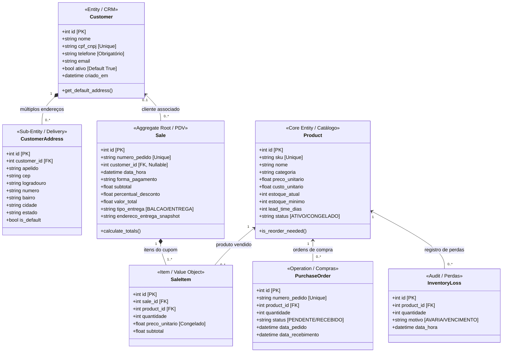

# 🗺️ GUIA VISUAL DE CLASSES & ARQUITETURA DE DADOS

> **Projeto:** CubeBox Mini  
> **Status:** Ativo  
> **Referência Técnica:** [`SDD-CBOX-CLASS-MODEL-V1.0.0.md`](file:///c:/Dev/CubeBox2/docs/sdd/SDD-CBOX-CLASS-MODEL-V1.0.0.md)  
> **Código de Origem:** [`backend/app/models.py`](file:///c:/Dev/CubeBox2/backend/app/models.py) | [`backend/app/schemas.py`](file:///c:/Dev/CubeBox2/backend/app/schemas.py)

---

## 🧭 Visão Panorâmica do Domínio (Mapa Visual ASCII)

```
                       [ 👤 Customer ] (CRM)
                              │
            ┌─────────────────┴─────────────────┐
            │ 1:N (Composição)                   │ 0..1:N (Associação)
            ▼                                   ▼
  [ 📍 CustomerAddress ]                  [ 🧾 Sale ] (Cupom Fiscal)
  - Endereços de Entrega                  - Total, Desconto, Snapshot
                                                │
                                                │ 1:N (Composição)
                                                ▼
                                          [ 📦 SaleItem ]
                                                │
       ┌────────────────────────────────────────┤
       │ N:1 (Referência SKU)                   │
       ▼                                        ▼
 [ 🏷️ Product ] (Catálogo/Estoque) <───── (Preço Unitário Congelado)
       │
       ├─────────────────────────────────┐
       │ 1:N (Ressuprimento)             │ 1:N (Avarias)
       ▼                                 ▼
 [ 🚚 PurchaseOrder ]             [ ⚠️ InventoryLoss ]
 - Ordens de Compra               - Quebras, Vencimentos, Perdas
```

---

## 📊 Diagrama UML Detalhado com Tipagem e Cardinalidades



---

## 🎨 Tabela Visual de Cores e Responsabilidades de Domínio

| Domínio | Entidades | Cor Conceitual | Função Prática no Negócio |
| :--- | :--- | :--- | :--- |
| **CRM / Clientes** | `Customer`, `CustomerAddress` | 🟣 Roxo / Índigo | Gestão da carteira de compradores, histórico de contato e múltiplos pontos de entrega. |
| **PDV / Vendas** | `Sale`, `SaleItem` | 🔵 Azul / Ciano | Caixa registrador, emissão de cupons, descontos e rastreabilidade fiscal imutável. |
| **Estoque Central** | `Product` | 🟢 Esmeralda / Verde | Catálogo com saldo em gôndola, preços, margem e ponto de ressuprimento. |
| **Suprimentos / IA** | `PurchaseOrder` | 🟡 Âmbar / Dourado | Pedidos de compra sugeridos pela IA (Machine Learning) para evitar ruptura. |
| **Auditoria / Avarias** | `InventoryLoss` | 🔴 Rosa / Vermelho | Controle de perdas líquidas por garrafas quebradas, validade ou extravios. |

