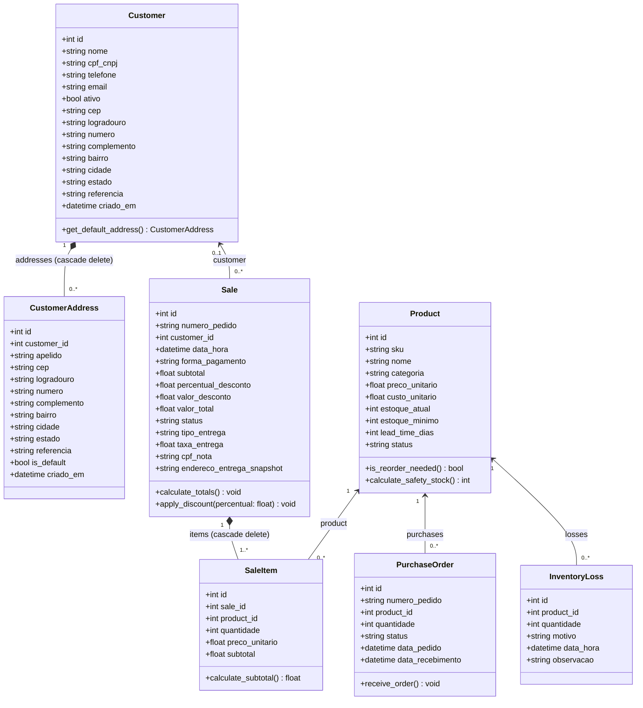

# 📐 SDD-CBOX-CLASS-MODEL-V1.0.0: Modelagem Orientada a Objetos e Diagrama de Classes

> **Projeto:** CubeBox Mini - Sistema Preditivo Integrado de Compras e Vendas  
> **Módulo:** Modelo de Domínio e Classes Relacionais (Domain-Driven Design / ORM)  
> **Versão:** 1.0.0  
> **Status:** Ativo  
> **Padrão:** IEEE 1016 (Software Design Document)  
> **Data:** 2026-10-31  

---

## 1. 🎯 Identificação & Visão Geral (Overview)

### 1.1 Propósito
Formalizar a arquitetura estrutural das classes de domínio do ecossistema **CubeBox Mini**. Este documento abrange as entidades do sistema implementadas no backend (`SQLAlchemy` e `Pydantic v2`), detalhando seus atributos, tipos primitivos, métodos operacionais de domínio e cardinalidades de relacionamento (associações, agregações e composições).

### 1.2 Relação com o Negócio & Léxico Ubíquo
Consome diretamente as definições estabelecidas em [`LEXICON.md`](file:///c:/Dev/CubeBox2/LEXICON.md) e na governança do projeto:
- **Product (Produto):** Item transacionado no catálogo de varejo/distribuição com controle de estoque e ciclo de reposição.
- **Customer & CustomerAddress (Cliente & Endereços):** Cadastro do cliente (CRM) com suporte a múltiplos endereços para entrega/delivery.
- **Sale & SaleItem (Venda & Itens do Pedido):** Registro atômico e imutável da transação de venda e respectivo cupom fiscal no PDV.
- **PurchaseOrder (Ordem de Compra):** Registro operacional de reabastecimento junto a fornecedores.
- **InventoryLoss (Avaria de Estoque):** Apontamento de perdas por avaria, vencimento ou extravio.

---

## 2. 🏛️ Princípios de Heurística & Design

- **SOLID (Single Responsibility & SRP):** Cada entidade de domínio encapsula exclusivamente o estado e os invariantes do seu próprio ciclo de vida.
- **Composição sobre Herança:** Entidades compostas como `Sale` e `SaleItem`, ou `Customer` e `CustomerAddress`, usam relações de propriedade estrita com ciclo de vida acoplado (`cascade="all, delete-orphan"`).
- **Snapshot Imutável:** Transações concluídas (`Sale`) armazenam snapshots históricos (`endereco_entrega_snapshot`, preços unitários congelados no `SaleItem`), protegendo o histórico financeiro e fiscal contra mutações de cadastros mestres.
- **Result Pattern & Validação em Camadas:** As classes ORM persistem o estado no SQLite, enquanto schemas Pydantic realizam a validação estrita em runtime nas bordas das APIs.

---

## 3. 📊 Diagrama de Classes UML (Mermaid)

---

## 4. 📝 Dicionário Detalhado das Entidades e Atributos

### 4.1 Entidade `Customer` (Cliente / CRM)
- **Responsabilidade:** Representar a pessoa física ou jurídica compradora, seu histórico e dados de contato.
- **Atributos:**
  - `id: int` [PK] — Identificador único sequencial.
  - `nome: string(150)` [Not Null] — Nome completo ou razão social.
  - `cpf_cnpj: string(20)` [Unique, Nullable] — Documento de identificação com máscara ou numérico.
  - `telefone: string(30)` [Not Null] — Telefone principal para notificações e entrega.
  - `email: string(120)` [Nullable] — E-mail para emissão de comprovantes digitais.
  - `ativo: bool` [Default: True] — Flag para exclusão lógica / soft-delete.
  - `cep, logradouro, numero, complemento, bairro, cidade, estado, referencia` — Campos legados mantidos para compatibilidade retroativa com clientes anteriores à Fase 8.0.
  - `criado_em: datetime` — Data e hora do cadastro inicial.

### 4.2 Entidade `CustomerAddress` (Endereço do Cliente)
- **Responsabilidade:** Gerenciar múltiplos endereços de entrega vinculados a um único cliente.
- **Atributos:**
  - `id: int` [PK] — Identificador único do endereço.
  - `customer_id: int` [FK -> customers.id, Not Null, Index] — Associação com o cliente pai.
  - `apelido: string(60)` [Default: "Principal"] — Nome amigável (Ex: "Casa", "Escritório", "Sítio").
  - `cep: string(10)` [Not Null] — Código postal formatado.
  - `logradouro: string(150)`, `numero: string(20)`, `complemento: string(50)`, `bairro: string(80)`, `cidade: string(80)`, `estado: string(2)` — Dados padronizados de localização.
  - `referencia: string(150)` [Nullable] — Ponto de referência para o entregador.
  - `is_default: bool` [Default: False] — Define se é o endereço sugerido automaticamente no PDV.

### 4.3 Entidade `Product` (Catálogo de Mercadorias)
- **Responsabilidade:** Manter os parâmetros mercadológicos, precificação e regras logísticas de cada SKU.
- **Atributos:**
  - `id: int` [PK] — Identificador único do item.
  - `sku: string(50)` [Unique, Not Null] — Código alfanumérico identificador do produto.
  - `nome: string(150)` [Not Null] — Descrição comercial do produto.
  - `categoria: string(100)` [Not Null] — Segmento (Ex: "Cervejas Especiais", "Vinhos").
  - `preco_unitario: float` [Not Null] — Preço de venda ao consumidor.
  - `custo_unitario: float` [Not Null] — Preço de aquisição junto ao fornecedor.
  - `estoque_atual: int` [Default: 0] — Quantidade física presente no armazém.
  - `estoque_minimo: int` [Default: 10] — Ponto de ressuprimento seguro.
  - `lead_time_dias: int` [Default: 2] — Tempo estimado entre o pedido de compra e o recebimento.
  - `status: string(20)` [Default: "ATIVO"] — Estado no catálogo (`ATIVO` ou `CONGELADO`).

### 4.4 Entidade `Sale` (Venda / Cupom Fiscal)
- **Responsabilidade:** Registrar a transação comercial executada no balcão ou via delivery.
- **Atributos:**
  - `id: int` [PK] — Identificador do pedido.
  - `numero_pedido: string(50)` [Unique, Not Null] — Código rastreável do cupom (ex: `PED-20261031-0001`).
  - `customer_id: int` [FK -> customers.id, Nullable] — Opcional (venda anônima de balcão permitida).
  - `data_hora: datetime` [Not Null] — Momento exato da conclusão da venda.
  - `forma_pagamento: string(50)` [Not Null] — `DINHEIRO`, `PIX`, `CARTAO_CREDITO`, `CARTAO_DEBITO`.
  - `subtotal: float`, `percentual_desconto: float`, `valor_desconto: float`, `valor_total: float` — Valores monetários auditáveis.
  - `status: string(20)` [Default: "CONCLUIDO"] — `CONCLUIDO` ou `CANCELADO`.
  - `tipo_entrega: string(20)` [Default: "BALCAO"] — `BALCAO` ou `ENTREGA`.
  - `taxa_entrega: float` [Default: 0.0] — Custo adicional de frete cobrado.
  - `cpf_nota: string(20)` [Nullable] — CPF do comprador impresso no cupom.
  - `endereco_entrega_snapshot: text` [Nullable] — Cópia congelada do endereço de entrega.

### 4.5 Entidade `SaleItem` (Item do Cupom de Venda)
- **Responsabilidade:** Detalhar individualmente os produtos associados a uma venda.
- **Atributos:**
  - `id: int` [PK] — Identificador do item.
  - `sale_id: int` [FK -> sales.id, Not Null] — Vínculo com o cabeçalho da venda.
  - `product_id: int` [FK -> products.id, Not Null] — Vínculo com o produto comercializado.
  - `quantidade: int` [Not Null] — Quantidade de unidades compradas.
  - `preco_unitario: float` [Not Null] — Valor do item fixado no instante da compra.
  - `subtotal: float` [Not Null] — Produto de `quantidade * preco_unitario`.

### 4.6 Entidade `PurchaseOrder` (Ordem de Reabastecimento)
- **Responsabilidade:** Rastrear aquisições de produtos para reposição do estoque central.
- **Atributos:**
  - `id: int` [PK] — Identificador da ordem.
  - `numero_pedido: string(50)` [Unique, Not Null] — Código único da ordem de compra.
  - `product_id: int` [FK -> products.id, Not Null] — Produto encomendado.
  - `quantidade: int` [Not Null] — Volume solicitado.
  - `status: string(30)` [Default: "PENDENTE"] — `PENDENTE`, `RECEBIDO` ou `CANCELADO`.
  - `data_pedido: datetime`, `data_recebimento: datetime` [Nullable] — Ciclo de lead time real.

### 4.7 Entidade `InventoryLoss` (Registro de Perdas e Avarias)
- **Responsabilidade:** Registrar baixas patrimoniais não provenientes de vendas comerciais diretas.
- **Atributos:**
  - `id: int` [PK] — Identificador do lançamento de avaria.
  - `product_id: int` [FK -> products.id, Not Null] — Produto danificado ou descartado.
  - `quantidade: int` [Not Null] — Número de unidades baixadas.
  - `motivo: string(50)` [Not Null] — `VENCIMENTO`, `AVARIA`, `FURTO`, `OUTRO`.
  - `data_hora: datetime` [Not Null] — Data e hora do registro.
  - `observacao: text` [Nullable] — Justificativa operacional detalhada.

---

## 5. 🔗 Matriz de Rastreabilidade

| Entidade | Código-Fonte SQLAlchemy | Código-Fonte Schemas | User Story Vinculada |
| :--- | :--- | :--- | :--- |
| `Customer` | [`backend/app/models.py:30`](file:///c:/Dev/CubeBox2/backend/app/models.py#L30) | [`backend/app/schemas.py:165`](file:///c:/Dev/CubeBox2/backend/app/schemas.py#L165) | `US-UI-04`, `US-UI-05-pos-smart-crm` |
| `CustomerAddress` | [`backend/app/models.py:56`](file:///c:/Dev/CubeBox2/backend/app/models.py#L56) | [`backend/app/schemas.py:140`](file:///c:/Dev/CubeBox2/backend/app/schemas.py#L140) | `US-UI-11-pos-quick-customer-addresses` |
| `Product` | [`backend/app/models.py:76`](file:///c:/Dev/CubeBox2/backend/app/models.py#L76) | [`backend/app/schemas.py:20`](file:///c:/Dev/CubeBox2/backend/app/schemas.py#L20) | `US-API-01-crud-products-sales` |
| `Sale` | [`backend/app/models.py:96`](file:///c:/Dev/CubeBox2/backend/app/models.py#L96) | [`backend/app/schemas.py:75`](file:///c:/Dev/CubeBox2/backend/app/schemas.py#L75) | `US-API-01`, `US-UI-01`, `US-UI-07` |
| `SaleItem` | [`backend/app/models.py:120`](file:///c:/Dev/CubeBox2/backend/app/models.py#L120) | [`backend/app/schemas.py:55`](file:///c:/Dev/CubeBox2/backend/app/schemas.py#L55) | `US-API-01-crud-products-sales` |
| `PurchaseOrder` | [`backend/app/models.py:134`](file:///c:/Dev/CubeBox2/backend/app/models.py#L134) | [`backend/app/schemas.py:110`](file:///c:/Dev/CubeBox2/backend/app/schemas.py#L110) | `US-API-02-model-serving-reorder` |
| `InventoryLoss` | [`backend/app/models.py:148`](file:///c:/Dev/CubeBox2/backend/app/models.py#L148) | [`backend/app/schemas.py:125`](file:///c:/Dev/CubeBox2/backend/app/schemas.py#L125) | `US-UI-05-inventory-hub` |

---

## 6. 🛡️ Resiliência & Integridade Transacional

1. **Integridade Referencial (Foreign Keys):** Habilitada no SQLite via evento `PRAGMA foreign_keys=ON;` no motor do SQLAlchemy para evitar registros órfãos.
2. **Atomicidade de Transações (ACID):** A inserção de `Sale` junto aos seus `SaleItem`s e a dedução do `estoque_atual` em `Product` ocorrem em uma única transação atômica (`session.commit()` ou `session.rollback()`).
3. **Rollback Strategy:** Em caso de exceção de persistência no banco, o contexto do FastAPI dispara rollback automático preservando os saldos prévios do estoque.

