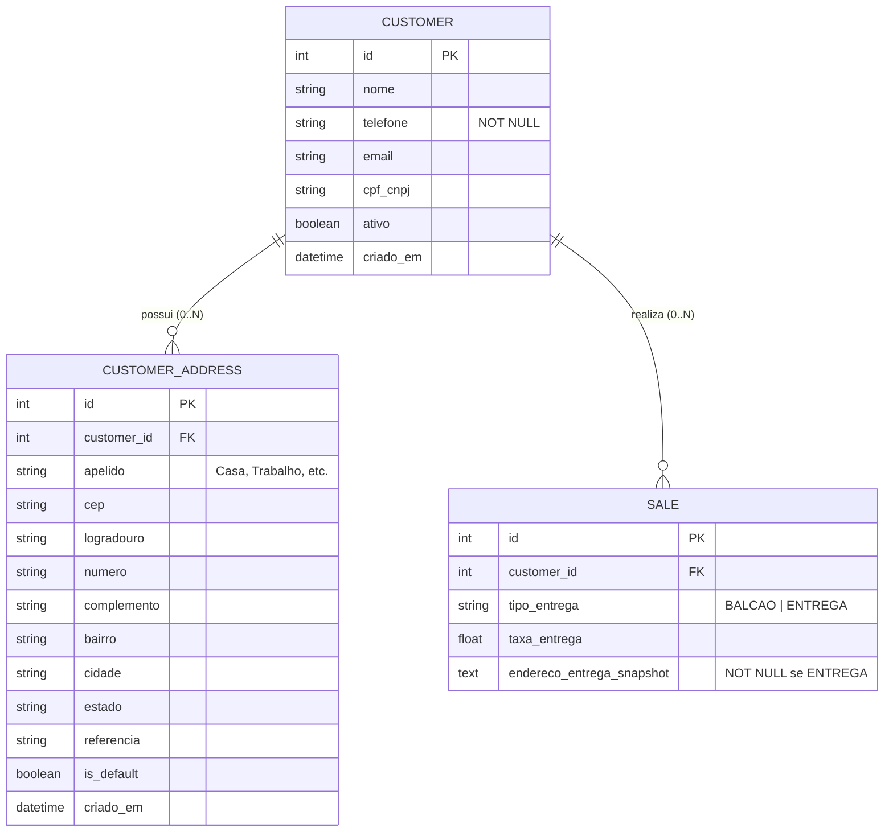

# 📐 SDD-CBOX-CRM-PDV-V1.0.0: Arquitetura de Clientes Multi-Endereço, Ação Rápida no PDV e Invariante de Delivery

> **Código do Documento:** `docs/sdd/SDD-CBOX-CRM-PDV-V1.0.0.md`  
> **Versão:** 1.0.0  
> **Status:** Aprovado / Em Implementação  
> **Autor:** Antigravity Architect  
> **Módulo:** CRM de Balcão, Ponto de Venda (PDV) e Logística de Entrega

---

## 1. Visão Geral e Contexto (IEEE 1016)

O CubeBox Enterprise possui um PDV de balcão de alta performance. Este documento especifica o subsistema de **Gestão de Clientes Multi-Endereço e Cadastro Ágil no PDV**, solucionando os gargalos identificados:
1. **Fricção Operacional no Caixa:** Ausência de botão de ação rápida para cadastramento direto de novos clientes no modal de seleção do PDV.
2. **Inflexibilidade no CRM e Logística:** Modelo de dados acoplado onde cada cliente possuía apenas 1 endereço estático, impossibilitando múltiplos locais de entrega (trabalho, residência, filial).
3. **Contactabilidade:** Obrigatoriedade de telefone válido (mínimo 10 dígitos) para comunicação e despacho.
4. **Invariante de Delivery:** Toda venda com modalidade de `ENTREGA` passa a exigir obrigatoriamente um endereço associado ao pedido.

---

## 2. Princípios de Engenharia & Heurística (SOLID, DRY, KISS)

- **Party and Address Pattern (Martin Fowler):** Desacoplamento da entidade `Customer` da entidade `CustomerAddress`. A relação torna-se $1:N$.
- **Invariante de Padrão Único (Single Default Invariant):** Um cliente pode ter $0$ ou $N$ endereços. O primeiro endereço cadastrado é automaticamente marcado com `is_default = true`. Quando um endereço tem seu status promovido a padrão, os outros endereços do mesmo cliente são atomicamente desmarcados.
- **Ergonomia Cognitiva e Inline Quick Action (Nielsen #3, #7):** No PDV, o operador pode acionar um formulário de cadastro rápido *in-place* sem sair do fluxo de venda nem perder os itens do carrinho.

---

## 3. Arquitetura de Dados e Schemas

### 3.1 Modelo Relacional (SQLAlchemy / SQLite)

### 3.2 Regras de Negócio e Validações de Fronteira

1. **Telefone Obrigatório:**
   - Backend (Pydantic v2): `telefone: str = Field(..., min_length=10, max_length=30)`.
   - Frontend (Zod / React): Validação de preenchimento obrigatório com máscara `(XX) XXXXX-XXXX` ou `(XX) XXXX-XXXX`.
2. **Endereço no Cadastro e Modal Unificado:**
   - O endereço é obrigatório por padrão na criação do cliente no CRM e PDV para entregas.
   - Fornece opção clara via switch *"Cliente sem endereço (apenas balcão / sem entrega)"* para clientes sem entrega.
   - Status cadastral expresso via toggle pill compacto (`ATIVO` / `INATIVO`).
   - Bloco compacto de endereços salvos: o endereço padrão (`is_default: true`) é posicionado no topo. Endereços não-padrão possuem botão *"Tornar Padrão"*, que oculta-se quando o endereço já é o padrão.
   - Botão `+ Outro Endereço` no CRM e PDV invoca o modal unificado com foco na seção de endereços (`initialShowAddress: true`), descartando modais paralelos legados.
3. **Invariante de Entrega:**
   - Na rota `POST /api/sales`, se `tipo_entrega == "ENTREGA"`, o campo `endereco_entrega_snapshot` não pode ser nulo ou vazio, e deve conter o logradouro e dados do endereço de entrega.

---

## 4. Plano de Migração e Compatibilidade Retroativa

1. **Migração do Banco de Dados (`apply_migrations`):**
   - Criação da tabela `customer_addresses` com chave estrangeira `customer_id -> customers.id`.
   - Se a tabela `customers` legada já possuir dados nas colunas `logradouro` e `cidade`, o script migra automaticamente cada endereço legado para a tabela `customer_addresses` marcando `is_default = 1`.
   - Assegurar que registros com telefone nulo recebam um valor padrão consistente ou atualização sem bloqueio.

---

## 5. Rastreabilidade Bidirecional

| Decisão Arquitetural | Requisito / Demanda | Componentes Afetados |
| :--- | :--- | :--- |
| Botão de Ação Rápida no PDV | Demanda de Atendimento Ágil | `CustomerSelectModal.tsx`, `CustomerQuickCreateModal.tsx` |
| Edição Rápida no Card da Comanda e Modal | Ajuste de Cadastro sem Sair do Caixa | `PosView.tsx`, `CustomerSelectModal.tsx`, `CustomerQuickCreateModal.tsx` |
| Botão de Cadastro de Endereço Inline | Indicação de Ausência de Endereço | `PosView.tsx` (Comanda) e `CustomerSelectModal.tsx` (Card de Endereço) |
| Relação 1:N de Endereços | Demanda de Múltiplos Endereços | `models.py`, `schemas.py`, `operations.py` |
| Primeiro endereço como Padrão | Regra de Negócio Default | `operations.py`, `CustomerAddress` |
| Telefone Obrigatório | Contactabilidade & Validação | `schemas.py`, `models.py`, `CustomersView.tsx` |
| Entrega Exige Endereço | Invariante de Despacho | `operations.py`, `CheckoutModal.tsx`, `PosView.tsx` |

---

## 6. Plano de Rollback e Resiliência

- A tabela `customer_addresses` é aditiva; as colunas antigas em `customers` são mantidas durante a fase de transição para garantir compatibilidade retroativa com leituras legadas.
- Transações com isolamento atômico garantem que o decremento de estoque e a validação do endereço de entrega ocorram sob rollback seguro em caso de exceção.
