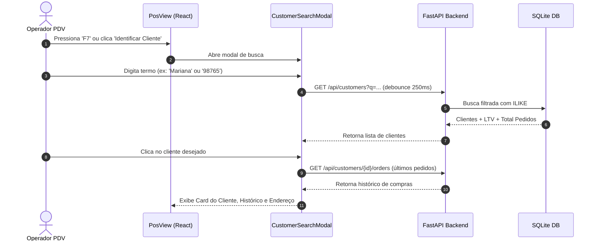

# 📐 SDD-CBOX-DATA-CRM-PDV-V1.0.0: Higienização de Dados, CRM & PDV Inteligente

> **Projeto:** CubeBox Enterprise / Mini  
> **Módulo:** Pipeline de Higienização de Dados, CRM Enriquecido e PDV com Modal Inteligente  
> **Versão:** 1.0.0  
> **Status:** Aprovado  
> **Padrão:** IEEE 1016 (Software Design Document)  
> **Data:** 2026-10-27  

---

## 1. 🎯 Identificação & Visão Geral (Overview)

### 1.1 Propósito
Este documento especifica formalmente a evolução da camada de dados, CRM e Ponto de Venda (PDV) do CubeBox:
1. **Pipeline de Ingestão e Higienização de Dados:** Capacidade de importar bases de clientes, produtos e vendas vindas de sistemas legados ou planilhas com falhas propositais, executando saneamento, deduplicação, validação de documentos oficiais (CPF/CNPJ) e normalização de endereços.
2. **CRM com Endereçamento Completo:** Evolução do cadastro de clientes para suporte a entregas (Logradouro, Número, Complemento, Bairro, Cidade, Estado, CEP).
3. **PDV com Modal de Busca & Repetição de Compra:** Substituição do seletor estático por busca rápida de clientes (Nome, Telefone, Documento), exibição do histórico de pedidos, fluxo de repetição de compra com 2 cliques e verificação de estoque físico disponível.
4. **Módulo de Entrega e Taxa:** Controle de taxa de entrega (padrão R$ 12,00, editável) e emissão com CPF na nota opcional (com toggle para usar cadastro ou informar avulso).
5. **Série Temporal Realista:** Geração de transações históricas simulando 90 dias contínuos com sazonalidade para treino preditivo de estoque.

### 1.2 Linguagem Ubíqua ([LEXICON.md](file:///c:/Dev/CubeBox2/LEXICON.md))
- **Canonicidade:** Armazenamento de dados sem formatação visual (ex: CPF somente dígitos `12345678901`).
- **Data Cleansing (Higienização):** Processo de detecção e correção/remoção de dados corrompidos, incompletos ou mal formatados.
- **LTV (Lifetime Value):** Valor monetário total acumulado que o cliente comprou no estabelecimento.
- **Repeat Order (Repetição de Pedido):** Ação no PDV que recria o carrinho a partir de uma venda pregressa, validando o estoque atual.

---

## 2. 🏛️ Princípios de Design & Heurísticas

- **KISS & SOLID:** O pipeline de higienização é modular e testável de forma isolada (`clean_customer_data`, `clean_product_data`).
- **Validação em Camadas (Fronteira Rígida):** Algoritmos de módulo 11 para CPF/CNPJ tanto no Pydantic v2 (backend) quanto no formulário TypeScript (frontend).
- **Resiliência e Idempotência:** A higienização pode ser executada sobre a base existente sem duplicar registros ou perder vendas passadas.

---

## 3. 📊 Modelagem Relacional & Migrações de Banco de Dados

### 3.1 Evolução da Tabela `customers`
```sql
ALTER TABLE customers ADD COLUMN cep VARCHAR(10);
ALTER TABLE customers ADD COLUMN logradouro VARCHAR(150);
ALTER TABLE customers ADD COLUMN numero VARCHAR(20);
ALTER TABLE customers ADD COLUMN complemento VARCHAR(50);
ALTER TABLE customers ADD COLUMN bairro VARCHAR(80);
ALTER TABLE customers ADD COLUMN cidade VARCHAR(80);
ALTER TABLE customers ADD COLUMN estado VARCHAR(2);
ALTER TABLE customers ADD COLUMN referencia VARCHAR(150);
```

### 3.2 Evolução da Tabela `sales`
```sql
ALTER TABLE sales ADD COLUMN tipo_entrega VARCHAR(20) DEFAULT 'BALCAO' NOT NULL; -- 'BALCAO' ou 'ENTREGA'
ALTER TABLE sales ADD COLUMN taxa_entrega REAL DEFAULT 0.0 NOT NULL;
ALTER TABLE sales ADD COLUMN cpf_nota VARCHAR(20);
ALTER TABLE sales ADD COLUMN endereco_entrega_snapshot TEXT; -- Snapshot do endereço no momento da venda
```

### 3.3 Triggers de Banco de Dados (SQLite Integrity Guards)
Garante a integridade do estoque diretamente na camada de banco:

```sql
-- Trigger para decrementar estoque na venda de item
CREATE TRIGGER IF NOT EXISTS trg_sale_items_after_insert
AFTER INSERT ON sale_items
BEGIN
    UPDATE products
    SET estoque_atual = estoque_atual - NEW.quantidade
    WHERE id = NEW.product_id;
END;

-- Trigger para bloquear estoque negativo (se regra de negócio exigir)
CREATE TRIGGER IF NOT EXISTS trg_block_negative_stock
BEFORE INSERT ON sale_items
FOR EACH ROW
WHEN (SELECT estoque_atual FROM products WHERE id = NEW.product_id) < NEW.quantidade
BEGIN
    SELECT RAISE(ABORT, 'Estoque insuficiente para o produto solicitado.');
END;

-- Trigger para estornar estoque no cancelamento
CREATE TRIGGER IF NOT EXISTS trg_sales_cancel_stock_restore
AFTER UPDATE OF status ON sales
WHEN NEW.status = 'CANCELADO' AND OLD.status != 'CANCELADO'
BEGIN
    UPDATE products
    SET estoque_atual = estoque_atual + (
        SELECT SUM(quantidade) FROM sale_items WHERE sale_id = NEW.id AND product_id = products.id
    )
    WHERE id IN (SELECT product_id FROM sale_items WHERE sale_id = NEW.id);
END;
```

---

## 4. 🧹 Arquitetura de Tratamento e Higienização de Dados

### 4.1 Regras de Higienização por Domínio

| Campo | Vício Comum de Importação | Regra de Tratamento / Higienização |
| :--- | :--- | :--- |
| **CPF / CNPJ** | Máscaras inconsistentes (`123.456...`), pontuações com letras (`111.62d.3d4-99`), nulos. | 1. Extração estrita de dígitos (`\D`).<br>2. Validação matemática via Módulo 11.<br>3. Se inválido: move para campo de observação/inconsistência e armazena `NULL` no campo canônico indexado. |
| **Telefone** | Espaços, traços, sem DDD, números com 8 ou 9 dígitos. | Extração de dígitos. Se comprimento = 10 ou 11 dígitos, normaliza para formato canônico nacional (ex: `11987654321`). |
| **Nomes** | Caixa alta desordenada (`MARIANA SILVA`), espaços duplos. | `title()` com exceção para conectivos (`de`, `da`, `dos`, `e`) e remoção de espaços redundantes (`strip()`). |
| **Endereço** | CEP sem hífen ou com pontos, campos vazios. | Sanitização de CEP (`8 dígitos`), uppercase em UF (`SP`), preenchimento automático opcional via CEP. |

### 4.2 Endpoint & Ferramenta de Importação e Higienização
* `POST /api/data/sanitize/customers`: Executa a higienização em lote nos clientes já existentes na base e gera relatório estruturado de alterações (Audit Trail).
* `POST /api/data/import`: Permite envio de CSV/JSON com opções de validação e limpeza imediata para catálogo, clientes e transações.

---

## 5. 🛒 Fluxo Operacional do PDV Inteligente

### 5.1 Busca e Seleção de Cliente via Modal


### 5.2 Fluxo de Repetição de Pedido (2 Cliques)
1. No histórico do cliente, cada pedido exibe o botão **"Repetir Pedido"**.
2. **Clique 1 (Seleção):** O sistema verifica a disponibilidade de cada item contra o `estoque_atual`:
   * Se todos os itens estiverem disponíveis: exibe badge verde *"Estoque 100% disponível"*.
   * Se algum item tiver estoque parcial ou zero: exibe alerta de aviso com a quantidade máxima permitida.
3. **Clique 2 (Confirmação):** Transfere os itens para o carrinho do PDV, fecha o modal automaticamente e foca na finalização da venda.

### 5.3 CPF na Nota e Taxa de Entrega
* **Opção CPF na Nota:**
  * Toggle: `[x] Emitir com CPF na Nota`.
  * Se o cliente selecionado tiver CPF válido: preenche automaticamente.
  * O operador pode desmarcar a sincronização e editar o CPF livremente para o cupom específico sem alterar o cadastro fixo do cliente.
* **Taxa de Entrega:**
  * Toggle: `[ ] Retirada no Balcão` | `[x] Entrega`.
  * Ao selecionar Entrega: exibe campo com valor default de **R$ 12,00** e input numérico editável.
  * O valor da taxa é discriminado no subtotal e somado ao `valor_total`.

---

## 6. 🕒 Geração de Dados Históricos Contínuos (90 Dias Realistas)

Para suportar o módulo preditivo sem dados concentrados em um único dia:
* Criar script determinístico `backend/scripts/seed_realistic_history.py`.
* Gera 90 dias de vendas retroativas a partir da data atual.
* Simula curvas de demanda real:
  * Picos em sextas-feiras e sábados (bebidas, snacks, gelo/carvão).
  * Distribuição de formas de pagamento (45% PIX, 35% Cartão Crédito/Débito, 20% Dinheiro).
  * 15% das vendas vinculadas a clientes fidelizados no CRM com geração de histórico de recompra.

---

## 7. 🛡️ Segurança, Máscaras e Resiliência em Formulários

1. **Máscaras Reativas no Frontend:**
   * CPF: `000.000.000-00`
   * Telefone: `(00) 00000-0000` ou `(00) 0000-0000`
   * CEP: `00000-000`
   * Moeda: `R$ #.##0,00`
2. **Defesa em Profundidade (OWASP):**
   * Prevenção de XSS com sanitização de texto livre.
   * Validação de regex estrito no frontend e rejeição com HTTP 422 no backend via Pydantic.
3. **DataTable:**
   * Desativação de `selectable` como padrão nas tabelas de listagem para evitar checkboxes ociosos sem ações em lote.
