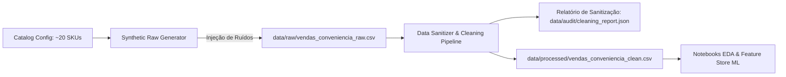

# 📐 SDD-CBOX-DATA-V1.0.0: Subsistema de Ingestão e Sanitização de Dados

> **Projeto:** CubeBox Mini - Sistema Preditivo Integrado de Compras e Vendas  
> **Módulo:** Ingestão, Geração de Dados Sintéticos Poluídos & Pipeline de Sanitização  
> **Versão:** 1.0.0  
> **Status:** Aprovado  
> **Padrão:** IEEE 1016 (Software Design Document)  
> **Data:** 2026-10-27  

---

## 1. 🎯 Identificação & Visão Geral (Overview)

### 1.1 Propósito
Definir a arquitetura, regras de transformação e fluxo operacional do pipeline de dados para o CubeBox Mini. O pipeline contempla:
1. Síntese programática de uma **base bruta e deliberadamente poluída** (`data/raw/vendas_conveniencia_raw.csv`), simulando falhas operacionais comuns de PDV/ERP de conveniência.
2. Mecanismos de auditoria, limpeza, imputação e deduplicação estruturada.
3. Exportação do dataset higienizado e consistente (`data/processed/vendas_conveniencia_clean.csv`) para treinamento dos modelos de Machine Learning (Árvore de Decisão, Random Forest, DBSCAN e Naive Bayes).

### 1.2 Linguagem Ubíqua & Relação com o Léxico
Este design document consome e expande estritamente os termos de [LEXICON.md](file:///c:/Dev/CubeBox2/LEXICON.md):
- **SKU (Stock Keeping Unit):** Identificador primário de catálogo.
- **Ponto de Venda (PDV):** Origem primária dos registros transacionais.
- **Ruptura de Estoque (Stockout):** Estado modelado nos dados.
- **CRISP-DM:** O módulo ancora as etapas 1 (Business Understanding) e 2/3 (Data Understanding & Data Preparation).

---

## 2. 🏛️ Princípios de Design & Heurísticas

- **KISS (Keep It Simple, Stupid):** O pipeline opera via scripts limpos e determinísticos em Python utilizando `pandas` e `numpy`, com sementes pseudoaleatórias (`random_state=42`) para total reprodutibilidade.
- **SOLID / Responsabilidade Única (SRP):** Separação estrita entre o gerador de anomalias/poluição e o sanitizador de dados.
- **Imutabilidade da Camada Raw:** Arquivos em `data/raw/` são somente leitura para o pipeline de limpeza; nunca são alterados *in-place*.
- **Result Pattern:** O sanitizador retorna relatório estruturado contendo métricas de descarte, imputação e normalização.

---

## 3. 🚨 Taxonomia de Poluição da Base de Dados (Ruído Simulado)

A base bruta (`raw`) deve conter intencionalmente os seguintes vícios para permitir a validação prática da fase de *Data Preparation*:

| Tipo de Poluição | Descrição Operacional | Impacto no ML sem Limpeza | Estratégia de Higienização |
| :--- | :--- | :--- | :--- |
| **Registros Duplicados** | Mesma transação gravada múltiplas vezes (duplo clique no PDV). | Superestimação de demanda. | Remoção via deduplicação por chave composta (`id_transacao` ou timestamp + SKU). |
| **Valores Nulos / Faltantes** | `categoria` em branco, `forma_pagamento` ausente, `preco_unitario` nulo. | Falha de execução nos algoritmos do Scikit-Learn. | Imputação por moda (categóricas) ou lookup do catálogo de produtos (SKU -> preço/categoria). |
| **Outliers Extremos / Digitação** | Quantidades absurdas (ex: 9999 ou 500 unidades de cerveja em transação única de balcão). | Distorção grave de média e variância para Regressores. | Filtro por regras de negócio (limite máximo razoável por transação) e capping estatístico. |
| **Inconsistências Categóricas** | `Cerveja`, `cerveja `, `CERVEJA`, `Bebidas Alcoolicas`. | Fragmentação de dummies/features categóricas. | Padronização textual (lowercase, strip whitespace) e mapeamento canônico. |
| **Datas e Formatos Inválidos** | Datas corrompidas ou fora do intervalo de simulação (90-180 dias). | Quebra na criação de Lag Features e ordenação temporal. | Conversão coercitiva (`pd.to_datetime(errors='coerce')`) e descarte de linhas sem timestamp válido. |
| **Valores Negativos/Zerados** | Quantidades ou preços negativos (devoluções não tratadas ou bugs de cadastro). | Previsões negativas e distorção de receita. | Separação ou descarte de vendas com quantidade <= 0. |

---

## 4. 🔄 Arquitetura de Dados & Fluxo (Data Pipeline)

---

## 5. 📋 Especificação dos Dados Sanitizados (Schema Final)

| Campo | Tipo | Descrição | Regras de Validação |
| :--- | :--- | :--- | :--- |
| `transaction_id` | String / UUID | Identificador único da transação | Obrigatório, sem duplicidade |
| `timestamp` | Datetime (ISO 8601) | Data e hora da venda | No intervalo de simulação (90-180 dias) |
| `sku` | String | Código único do item (ex: `SKU-BEB-001`) | Contido no catálogo mestre |
| `product_name` | String | Nome comercial padronizado | Canônico, sem espaços extras |
| `category` | String | Categoria do produto | Canônica (`Bebidas`, `Snacks`, `Tabacaria`, etc.) |
| `quantity` | Integer | Quantidade vendida | Inteiro positivo ($1 \le q \le 50$) |
| `unit_price` | Float | Preço unitário praticado (R$) | Float positivo conforme catálogo |
| `total_amount` | Float | Valor total ($quantity \times unit\_price$) | Consistente com cálculo unitário |
| `payment_method` | String | Método de pagamento | `Dinheiro`, `Cartão Débito`, `Cartão Crédito`, `PIX` |

---

## 6. 🛡️ Plano de Rollback & Observabilidade

- **Rollback:** Caso a base de dados tratada apresente anomalias pós-treinamento, a restauração é imediata reexecutando o pipeline com a semente fixada (`seed=42`).
- **Observabilidade:** Geração de arquivo de log/auditoria (`data/audit/cleaning_report.json`) detalhando:
  - Total de registros lidos da base bruta.
  - Quantidade de nulos imputados por coluna.
  - Quantidade de registros duplicados removidos.
  - Registros anômalos expurgados por categoria de regra.
  - Taxa de integridade final (% de linhas aproveitadas).
