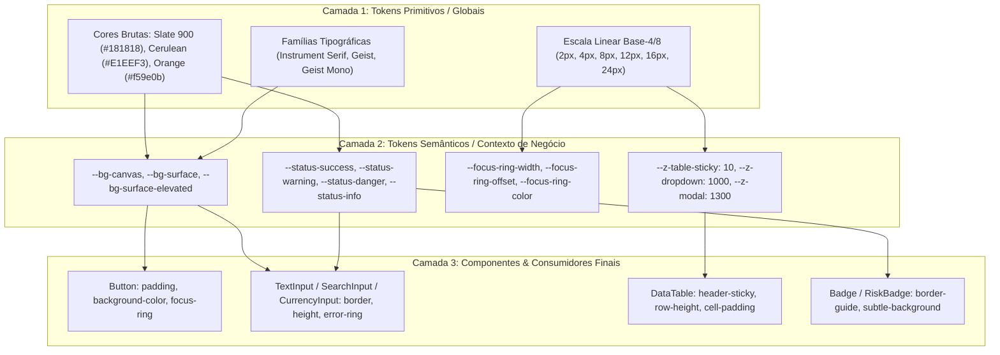

# 📐 Software Design Document (SDD) — CubeBox Mini Design System
# Padrão IEEE 1016

> **Identificador do Documento:** `SDD-CBOX-DESIGN-SYSTEM-V1.0.0`  
> **Status:** `APPROVED`  
> **Versão:** `1.0.0`  
> **Data:** `2026-10-27`  
> **Autores / Engenheiros:** `Antigravity Agent (Governance Committee)`  
> **Rastreabilidade de Negócio:** `[REQ-DS-001, REQ-DS-002, REQ-DS-003, REQ-DS-004, REQ-DS-005]`  
> **ADRs Relacionadas:** `[ADR-005, ADR-006]`  
> **Vinculação:** [SDD-CBOX-UI-V1.0.0.md](file:///c:/Dev/CubeBox2/docs/sdd/SDD-CBOX-UI-V1.0.0.md) | [DESIGN-SYSTEM-MATURITY.md](file:///c:/Dev/CubeBox2/docs/DESIGN-SYSTEM-MATURITY.md)

---

## 🏛️ 1. Introdução e Visão Geral (Overview)

### 1.1. Propósito do Sistema
O **CubeBox Mini Design System** é a infraestrutura de interface visual, ergonômica e comportamental do sistema integrado de compras, vendas e previsão de demanda do CubeBox Mini. Alinhado ao ecossistema enterprise do CubeBox, ele adota uma arquitetura estrita de **Tokens DTCG (W3C)**, **Dual-Theme com Zero Preto e Branco Puros**, **Acessibilidade WCAG 2.1 AA/AAA**, **Componentes Atômicos Tipados**, **Quiet Luxury Typography** e **Feedback Sem Pânico**.

### 1.2. Escopo e Limites de Fronteira (Boundaries)
- **O que faz:**
  - Padronização em 3 camadas de tokens (Globais/Raw, Semânticos/Alias e Componentes).
  - Componentes de alta frequência operacional para PDV e Cockpit (Botões com hotkey, Inputs monetários/desconto sincronizado, Badges táteis de risco e clusters ML, Tabelas densas com sticky headers, Modais com Escape-to-Close).
  - Alternância imediata entre Dark Mode (`#181818` canvas, `#242424` superfícies) e Light Mode (`#E1EEF3` gelo cerúleo, `#EDF5F8` superfícies), garantindo contraste WCAG AAA (> 9.5:1).
  - Feedback visual anti-pânico com borda demarcada de 4px sobre fundo neutro elevado (`--bg-surface-elevated`) e tipografia neutra legível.
- **O que NÃO faz:**
  - Não faz cálculos de inferência estatística no cliente (consome endpoints FastAPI serializados em `.pkl`).
  - Não impõe bibliotecas monolíticas pesadas (Tailwind, Material UI ou Bootstrap); opera 100% em CSS Modules e variáveis nativas do CSS.

---

## ⚖️ 2. Heurísticas e Princípios Arquiteturais

| Princípio | Aplicação Prática no Design System do CubeBox Mini |
| :--- | :--- |
| **KISS (Keep It Simple, Stupid)** | Componentes atômicos com APIs previsíveis, CSS Modules escopados e zero abstrações desnecessárias. |
| **SOLID & Clean Architecture** | Responsabilidade única por átomo/molécula. Inversão de dependência através de handlers tipados (`onChange`, `onAction`). |
| **Composição > Herança** | Montagem de painéis e tabelas operacionais através de blocos e células atômicas, sem acoplamento hierárquico. |
| **Data Locality (Colocalização)** | Estrutura modular onde cada componente detém seu `.tsx`, `.module.css`, `.types.ts` e `.spec.tsx` no mesmo diretório. |
| **WCAG 2.1 AA/AAA Compulsória** | Contraste mínimo de 4.5:1 em textos e 3:1 em controles gráficos; anel duplo em `:focus-visible` e respeito a `prefers-reduced-motion`. |
| **Anti-Panic Ergonomics** | Alertas e toasts não usam fundos saturados berrantes; utilizam borda lateral semântica e texto contrastante sobre fundo neutro. |

---

## 🏷️ 3. Semântica e Linguagem Ubíqua (DDD & DTCG)

> [!NOTE]
> Alinhado ao [LEXICON.md](file:///c:/Dev/CubeBox2/LEXICON.md) e ao padrão W3C DTCG.

| Termo Ubíquo | Camada / Papel | Definição Semântica |
| :--- | :--- | :--- |
| **`Global Token (Option)`** | *Base Primitive* | Valor primitivo estático (ex: `#181818`, `16px`, `400`). |
| **`Semantic Token (Alias)`** | *Design Role* | Intenção funcional da variável (ex: `--bg-surface`, `--status-warning`, `--space-4`). |
| **`Component Token`** | *Scoped Token* | Token restrito a um átomo (ex: `--btn-height`, `--table-cell-padding`). |
| **`Quiet Luxury Typography`** | *Visual Identity* | Tripla tipográfica aprovada: *Instrument Serif* (Display/Títulos executivos), *Geist* (Interface/Rótulos) e *Geist Mono* (Numerais/Moedas com `tabular-nums`). |
| **`Dual-Theme Cerulean/Graphite`** | *Color Architecture* | Alternância entre Modo Claro Cerúleo (`#E1EEF3`) e Modo Escuro Grafite (`#181818`), banindo `#000` e `#FFF` absolutos. |
| **`Anti-Panic Feedback`** | *Ergonomics* | Tratamento de notificações e alertas com superfície neutra elevada e borda semântica demarcada de 4px. |

---

## 📐 4. Estrutura Arquitetural (C4 & W3C DTCG)

### 4.1 Arquitetura em 3 Camadas de Tokens


---

## 🔬 5. Requisitos Não-Funcionais e Contratos

### 5.1 Requisitos Não-Funcionais (RNFs)
- **Contraste Mínimo:** Texto `>= 4.5:1`, elementos gráficos e texto grande `>= 3:1`. Relações oficiais no tema cerúleo e grafite atingem `> 9.5:1` (WCAG AAA).
- **Tempo de Transição de Tema:** `< 16ms` (sem remontar componentes via injeção CSS de `data-theme`).
- **Motion:** Microinterações suaves (150ms a 250ms) usando aceleração de hardware (`transform`, `opacity`) e desligamento total via `@media (prefers-reduced-motion: reduce)`.
- **CSS Scoping:** 100% de estilos via CSS Modules (`.module.css`), sem seletores globais fora de `variables.css`.

### 5.2 Contratos TypeScript dos Componentes Atômicos
```typescript
export interface ButtonProps extends React.ButtonHTMLAttributes<HTMLButtonElement> {
  variant?: 'primary' | 'secondary' | 'danger' | 'ghost';
  size?: 'sm' | 'md' | 'lg';
  loading?: boolean;
  hotkey?: string;
  icon?: React.ReactNode;
}

export interface BadgeProps {
  label: string;
  variant?: 'neutral' | 'success' | 'warning' | 'danger' | 'info';
  pulse?: boolean;
  size?: 'sm' | 'md';
  icon?: React.ReactNode;
}

export interface BankingNumberInputProps {
  value: number;
  onChange: (value: number) => void;
  mode?: 'currency' | 'percent' | 'integer' | 'decimal';
  decimals?: number;
  prefix?: string;
  suffix?: string;
  min?: number;
  max?: number;
  step?: number;
  label?: string;
  error?: string;
}
export interface DataTableColumn<T> {
  key: string;
  header: string;
  align?: 'left' | 'center' | 'right';
  width?: string;
  sortable?: boolean;
  sortFn?: (a: T, b: T) => number;
  render?: (item: T) => React.ReactNode;
}

export interface DataTableProps<T> {
  columns: DataTableColumn<T>[];
  data: T[];
  keyExtractor: (item: T) => string | number;
  density?: 'compact' | 'comfortable';
  onRowClick?: (item: T) => void;
  emptyMessage?: string;
  selectable?: boolean;
  batchActions?: BatchAction<T>[];
  onSelectionChange?: (selectedItems: T[]) => void;
  pagination?: boolean;
  pageSizeOptions?: number[];
  defaultPageSize?: number;
  initialSortKey?: string;
  initialSortDirection?: 'asc' | 'desc' | null;
}
```

---

## 🗺️ 6. Matriz de Rastreabilidade Bidirecional

| ID do Requisito | Subsistema / Componente | Critério de Aceitação / Teste |
| :--- | :--- | :--- |
| **`REQ-DS-001`** | `src/styles/variables.css` | Dual-Theme com `#E1EEF3` e `#181818`; contraste WCAG AAA validado. |
| **`REQ-DS-002`** | `src/components/Common/` | Componentes atômicos com estados `hover`, `active`, `focus-visible`, `loading`, `disabled`. |
| **`REQ-DS-003`** | `src/styles/variables.css` | Curvas de aceleração suave e suporte a `prefers-reduced-motion`. |
| **`REQ-DS-004`** | `src/components/Shell/` | Navegação lateral limpa, hotkeys operacionais e barras de rodapé/HUD. |
| **`REQ-DS-005`** | `docs/DESIGN-SYSTEM-MATURITY.md` | Matriz de maturidade e conformidade de tokens W3C DTCG. |
| **`REQ-DS-006`** | `src/components/common/BankingNumberInput/` | Digitação numérica à direita (ATM/Bancária) com máscara dinâmica e `tabular-nums`. |
| **`REQ-DS-007`** | `src/components/common/DataTable/` | Paginação determinística (NN/g), Tri-state sorting acessível e contextual dual bulk action bar (topo e rodapé) com atalho `Escape`. |
| **`REQ-DS-008`** | `src/components/common/DataTable/DataTable.module.css` | Feedback cromático e contorno demarcado em linhas selecionadas: faixa lateral de 3px em `--color-interactive-primary`, bordas superior/inferior em `--border-focus` e fundo sutil em `--primary-glow`. |

---

## 🛡️ 7. Governança e Diretrizes de Uso (Do's & Don'ts)

| Categoria | ✅ O que FAZER (Do) | ❌ O que NUNCA fazer (Don't) |
| :--- | :--- | :--- |
| **Cores & Superfícies** | Usar `--bg-surface-elevated` e bordas semânticas de 4px para feedbacks; destacar linhas selecionadas em tabelas com `--primary-glow` e borda ativa `--border-focus`. | Não usar fundos saturados neon ou texto colorido sobre fundos coloridos. |
| **Tipografia & Numerais** | Usar `Geist Mono` com `tabular-nums` para moedas, SKUs e saldos. | Não usar fontes sem alinhamento monoespaçado em números (gera tremor na tela). |
| **Entrada Numérica (Inputs)** | Usar digitação à direita (`text-align: right`) com máscara gradual para moedas, % e inteiros (`BankingNumberInput`). | Não usar inputs textuais simples ou `type="number"` sem formatação contínua de centavos/milhar. |
| **Acessibilidade (A11y)** | Fornecer `:focus-visible` com anel duplo em todos os controles interativos. | Não remover contornos com `outline: none` sem alternativa visível acessível. |
| **Motion & Animações** | Usar microinterações sutis (150-250ms) com aceleração e desaceleração suave. | Não usar animações oscilantes bruscas ou transições lentas que atrasem o operador. |

---
_Documento formalizado conforme padrão IEEE 1016 e governança do CubeBox._
