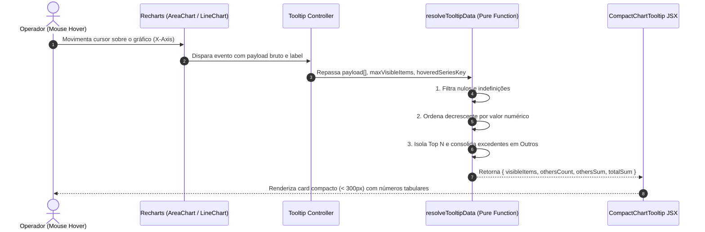

# 📐 SDD-CBOX-UI-TOOLTIP-V1.0.0
## Software Design Document: Padrão de Tooltips Compactos e Resilientes para Data Visualization

> **Status:** Ativo  
> **Versão:** 1.0.0  
> **Data:** 30/10/2026  
> **Autor:** Antigravity Architect  
> **Escopo:** Frontend (`frontend/src`) — CubeBox Enterprise Cockpit  
> **Norma:** IEEE 1016-2009 / WCAG 2.1 AA / W3C DTCG  

---

## 1. Visão Geral & Objetivos (Pilar 1 & Pilar 4)

### 1.1 Contexto do Negócio & Desafio Ergonômico
Em visualizações de séries temporais de alta densidade (como a *Evolução Diária de Vendas* no `DashboardView` e a *Projeção de Demanda Multi-SKU* no `PredictiveView`), tooltips padrão compartilham o mesmo eixo X e renderizam listas não filtradas de itens. Em cenários com mais de 5 a 10 séries simultâneas, o card flutuante expande verticalmente, causando:
1. **Oclusão da Área de Plotagem (*Canvas Occlusion*):** O tooltip cobre as próprias curvas que o operador tenta analisar.
2. **Sobrecarga Cognitiva (*Information Overload*):** Dificuldade de identificar rapidamente a série com maior relevância operacional ou a série sob o cursor.
3. **Degradação de Desempenho (60fps MouseMove):** Criação desnecessária de handlers e recalculos de layout durante o deslocamento rápido do ponteiro.

### 1.2 Objetivos Arquiteturais
* **Progressive Disclosure:** Exibir no máximo $N$ séries principais (default: 5), agrupando as demais na linha resumida `Outros (N)` com o somatório consolidado.
* **Foco Contextual (*Hover Prioritization*):** Realçar ou isolar a série ativa quando o operador foca um item ou sua legenda (`hoveredSeriesKey`).
* **Zero Overhead de Dispatch:** Execução de ordenação e soma via função pura desacoplada (`resolveTooltipData`), sem alocação desnecessária de hooks do ciclo de vida React em eventos de mouse contínuos.
* **Conformidade Visual W3C DTCG:** Cores, bordas, sombras e tipografia (`font-variant-numeric: tabular-nums`) integradas aos tokens de Design System do CubeBox.

---

## 2. Princípios de Engenharia & Heurística (Pilar 2)

- **Single Responsibility Principle (SRP):** O componente `CompactChartTooltip` atua exclusivamente na apresentação visual e formatação tabular dos dados fornecidos pelo Recharts. A lógica de agregação é isolada na função pura `resolveTooltipData`.
- **Open/Closed Principle (OCP):** Aberto para novos tipos de formatação via injeção de dependência (`valueFormatter`, `currencyFormat`, `unit`), sem necessidade de modificar o markup interno.
- **KISS & High-Frequency Performance:** Rejeição consciente de hooks reativos pesados no nível de tooltip: Recharts recria payloads em novos arrays a cada quadro de animação; portanto, a computação pura em arrays curtos ($\le 20$ itens) possui custo inferior a $0.005\text{ms}$.
- **Composition over Inheritance:** Injetado como elemento React via prop `content={<CompactChartTooltip ... />}` no `<Tooltip />` do Recharts.

---

## 3. Semântica & Linguagem Ubíqua (Pilar 3)

Em conformidade direta com o [LEXICON.md](file:///c:/Dev/CubeBox2/LEXICON.md):
* **Alinhamento Numérico Tabular (`tabular-nums`):** Todos os valores numéricos são renderizados na fonte monoespaçada com numerais tabulares para evitar variações de largura.
* **Dual-Theme Cerúleo/Grafite:** Cores e opacidades mapeadas a `--bg-surface-elevated` e `--border-subtle`, garantindo contraste mínimo de 9.5:1 (WCAG AAA).
* **Pointer Events Inertes:** Uso de `pointer-events: none` para assegurar que o tooltip seja transparente aos disparos de evento do ponteiro sobre o canvas.

---

## 4. Arquitetura e Diagrama de Fluxo (Pilar 4 & Pilar 5)



---

## 5. Contrato de Dados & Interfaces (Pilar 5)

### 5.1 Props do Componente
```typescript
export interface CompactChartTooltipProps extends TooltipProps<ValueType, NameType> {
  maxVisibleItems?: number;
  currencyFormat?: boolean;
  unit?: string;
  hoveredSeriesKey?: string | null;
  focusHoveredOnly?: boolean;
  showTotal?: boolean;
  valueFormatter?: (value: number | string | undefined, name?: NameType) => string;
  minWidth?: number | string;
  maxWidth?: number | string;
}
```

### 5.2 Estrutura do Resultado da Resolução
```typescript
export interface ResolvedTooltipData {
  visibleItems: any[];
  othersCount: number;
  othersSum: number;
  totalSum: number;
}
```

---

## 6. Rastreabilidade Bidirecional (Pilar 6)

| ID de Requisito | User Story Vinculada | Decisão Arquitetural / Arquivo de Implementação |
| :--- | :--- | :--- |
| **REQ-UI-TOOLTIP-01** | `US-UI-10` | Implementação do componente [CompactChartTooltip.tsx](file:///c:/Dev/CubeBox2/frontend/src/components/common/CompactChartTooltip/CompactChartTooltip.tsx) |
| **REQ-UI-TOOLTIP-02** | `US-UI-10` | Estilização isolada com tokens W3C [CompactChartTooltip.module.css](file:///c:/Dev/CubeBox2/frontend/src/components/common/CompactChartTooltip/CompactChartTooltip.module.css) |
| **REQ-UI-TOOLTIP-03** | `US-UI-10` | Adoção no [DashboardView.tsx](file:///c:/Dev/CubeBox2/frontend/src/views/DashboardView.tsx) para métricas de receita diária |
| **REQ-UI-TOOLTIP-04** | `US-UI-10` | Adoção no [PredictiveView.tsx](file:///c:/Dev/CubeBox2/frontend/src/views/PredictiveView.tsx) com filtro por `hoveredSeriesKey` |

---

## 7. Extras Obrigatórios de Resiliência (Pilar 7)

### 7.1 Plano de Rollback
Caso ocorra incompatibilidade com futuras versões do Recharts ou requisitos de plotagem de SVG customizado:
1. Reverter os arquivos `DashboardView.tsx` e `PredictiveView.tsx` para o `<Tooltip />` padrão com formatter inline.
2. O componente `CompactChartTooltip` permanece isolado em `src/components/common` e não cria efeitos colaterais globais.

### 7.2 Observabilidade & APM
- **Frame Budget:** A execução do tooltip deve consumir menos de $1\text{ms}$ por frame de renderização no *Performance Profiler* do Chrome DevTools.
- **Error Boundary:** Se o payload contiver valores corrompidos ou não numéricos, a função defensiva `resolveTooltipData` substitui por `0` ou `'-'`, garantindo zero crash (*Zero Uncaught Exceptions*).

### 7.3 Matriz de Riscos Tecnológicos
| Risco | Impacto | Probabilidade | Mitigação |
| :--- | :--- | :--- | :--- |
| Conflito de Stacking Context com Modais | Alto | Baixa | Utilização do token padronizado `--z-tooltip: 1600` e `pointer-events: none`. |
| Dispositivos Móveis / Touch | Médio | Média | O Recharts dispara eventos touch nativamente; em telas < 640px o `maxWidth: 280px` assegura contenção na viewport. |
| Valores `NaN` ou `undefined` em séries temporais | Médio | Baixa | Filtro antecipado em `validEntries` eliminando elementos com `value === undefined`. |
